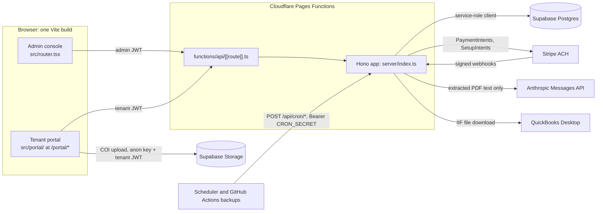

# ORA PM

**Property-management platform for a shallow-bay industrial/flex portfolio — an admin console and a tenant portal on one Hono API.**

[](https://github.com/ZeOoba/ora-pm/actions/workflows/ci.yml)
[](https://github.com/ZeOoba/ora-pm/actions/workflows/migration-numbers.yml)

One Vite/React build serves two front ends. The **admin console** covers properties, units, tenants, leases (with AI-assisted lease intake), billing, AR and collections, payments, CAM reconciliation, expenses, budgets, renewals, insurance certificates, critical dates, tenant statements, reports, a native general ledger (chart of accounts, opening balances, and AR posting for accrual- and cash-basis LLCs), and QuickBooks Desktop IIF export. The **tenant portal** (`/portal/*`) lets tenants view their lease, charges, payments and documents, pay by ACH and upload insurance certificates. Both call one Hono API running as Cloudflare Pages Functions over Supabase Postgres. Monthly billing, autopay, critical-date alerts and late fees run as HTTP cron endpoints, because Cloudflare Pages has no native cron.

## Contents

- [Architecture](#architecture)
- [Tech stack](#tech-stack)
- [Repository layout](#repository-layout)
- [Getting started](#getting-started)
- [Scripts](#scripts)
- [Testing and CI](#testing-and-ci)
- [Deployment](#deployment)
- [Database and migrations](#database-and-migrations)
- [Scheduled jobs](#scheduled-jobs)
- [Security and operational notes](#security-and-operational-notes)
- [Contributing](#contributing)
- [Further reading](#further-reading)

## Architecture



**Request path.** Every `/api/*` request passes through, in order: the error handler, the Stripe webhook router (mounted before CORS so the raw body survives signature verification), an explicit CORS allowlist, then `adminAuthMiddleware` and a 120 req/min admin-mutation rate limit. Five roots are exempt from admin auth because they authenticate themselves (`ADMIN_EXEMPT` in [`server/index.ts`](server/index.ts)):

| Root | Gate |
|---|---|
| `/api/webhooks` | Stripe signature |
| `/api/cron` | `cronAuthMiddleware` (Bearer `CRON_SECRET`), 10 calls/hour per path |
| `/api/portal`, `/api/stripe` | `tenantAuthMiddleware` (tenant JWT); money-movement routes also require MFA (AAL2) |
| `/api/health` | public |

`/api/admin` (tenant portal invite and revoke) is deliberately **not** exempt.

<details>
<summary><strong>API route map</strong> (24 routers in <code>server/routes/</code>)</summary>

| Mount | File | Notes |
|---|---|---|
| `/api/properties`, `/api/units`, `/api/tenants` | `properties.ts`, `units.ts`, `tenants.ts` | CRUD; tenants also has `/:id/correspondence` and `/:id/portal-preview` |
| `/api/leases` | `leases.ts` | CRUD, `/:id/amendments`, `/:id/notices` |
| `/api/charges`, `/api/payments` | `charges.ts`, `payments.ts` | Ledger posting. `DELETE /api/charges/:id` hard-deletes a manual charge; auto-generated and voided charges are refused |
| `/api/cam` | `cam.ts` | CAM pool, recoverable expenses, calculate, atomic approve |
| `/api/expenses`, `/api/budgets` | `expenses.ts`, `budgets.ts` | Operating expenses and budgets |
| `/api/renewals`, `/api/insurance` | `renewals.ts`, `insurance.ts` | Renewal pipeline, certificate tracking |
| `/api/collections` | `collections.ts` | Payment promises and disputes |
| `/api/reports` | `reports.ts` | `ar-aging`, `cash-activity`, `financials`, `income-statement-12mo`, `rent-roll`, `critical-dates`, `actuals` |
| `/api/statements` | `statements.ts` | Per-lease statement, batch, Outlook draft packet |
| `/api/gl` | `gl.ts` | GL entities, chart of accounts (incl. QuickBooks IIF account import), opening balances, AR posting (account roles, tie-out, preview + post run), journal + reversal, trial balance, period lock |
| `/api/exports` | `exports.ts` | `GET /qb-iif`: QuickBooks Desktop IIF export |
| `/api/intake` | `intake.ts` | `POST /lease`: AI lease extraction (see [Security](#security-and-operational-notes)) |
| `/api/search` | `search.ts` | Global search |
| `/api/cron` | `cron.ts` | `monthly-billing`, `critical-dates-alerts` (+ `/ack`), `delinquency-check` |
| `/api/stripe`, `/api/webhooks` | `stripe.ts`, `webhook.ts` | Tenant customer / setup-intent / payment-intent; `POST /webhooks/stripe` deduped in `stripe_webhook_events` |
| `/api/portal`, `/api/portal/insurance` | `portal.ts`, `portal-insurance.ts` | `/me`, `/charges`, `/payments`, `/lease`, `/aging`, `/documents`, `PATCH /autopay` (AAL2); COI metadata |
| `/api/admin` | `portal-auth.ts` | Tenant portal invite / revoke access (admin-gated) |

</details>

## Tech stack

| Layer | Technology |
|---|---|
| Front end | React 19, React Router 8, TanStack Query 5 and Table, Tailwind CSS 4, shadcn/ui on Radix primitives, Recharts, cmdk, sonner |
| Build | Vite 6, TypeScript 5 (`tsc --noEmit` before every build) |
| API | Hono 4 on Cloudflare Pages Functions (`hono/cloudflare-pages`), Zod validation |
| Data | Supabase Postgres (service-role client server-side), Supabase Auth (admin and tenant sessions, TOTP MFA), Supabase Storage |
| Payments | Stripe ACH (`us_bank_account`) via `stripe` and Stripe Elements |
| AI | Anthropic Messages API for lease extraction (default model in [`server/lib/models.ts`](server/lib/models.ts)); PDF text via `unpdf` |
| Accounting | QuickBooks Desktop IIF export and chart-of-accounts import |
| Tests | Vitest 4, pg-mem and PGlite (migration tests), real Postgres 17 for the GL SQL suite |
| CI/CD | GitHub Actions, Wrangler 4, Supabase CLI (pinned) |

## Repository layout

```text
.
├── functions/api/[[route]].ts   Pages Functions entry: hands every /api/* request to the Hono app
├── server/
│   ├── index.ts                 App assembly: middleware order, CORS allowlist, ADMIN_EXEMPT, route mounts
│   ├── routes/                  One Hono router per resource (24 files)
│   ├── middleware/              admin-auth, tenant-auth, aal-guard (MFA), cron auth, error handler
│   ├── lib/                     Business logic: billing, rent schedule, CAM, AR aging, GL, statements,
│   │                            IIF export/import, lease extraction, confidentiality guard, Stripe, rate limit
│   └── db/client.ts             Supabase service-role client (server-only)
├── src/
│   ├── router.tsx               Admin route table (lazy-loaded pages behind AdminAuthGuard + AppShell)
│   ├── pages/                   Admin pages, one folder per area (today, portfolio, leases, money, books, …)
│   ├── portal/                  Tenant portal: PortalApp (session + MFA guard), PortalRouter, pages, lib
│   ├── components/              App shell, data table, charts, forms, shadcn ui/ primitives
│   └── lib/                     Admin Supabase client, API wrapper, formatting, validation
├── supabase/
│   ├── migrations/              0001–0029 SQL migrations: the schema source of truth (read its README)
│   ├── tests/                   GL SQL suites (core, opening balance, accrual and cash AR posting) on real Postgres
│   └── config.toml              Supabase CLI local config
├── tests/                       Vitest suites: components, config, db, evals, lib, middleware, pages,
│                                portal, routes, scripts, unit (+ fixtures/, setup.ts)
├── scripts/                     CI gates, cron triggers, backfills, import, pre-push confidentiality scan
├── evals/lease-intake-model-eval/  Opt-in model accuracy eval for lease intake (real API cost)
├── docs/                        Design system and dated implementation plans
├── public/_headers              Cloudflare Pages security headers
├── .github/workflows/           ci, db-migrate, migration-numbers, delinquency-backup, monthly-billing-backup,
│                                branch-cleanup
└── wrangler.toml                Pages project config (build output ./dist)
```

## Getting started

### Prerequisites

- Node.js 22 (the version CI uses) and npm
- A Supabase project (or the Supabase CLI for a local stack)
- Python 3 for the pre-push confidentiality hook
- Optional: `psql` and an empty Postgres 16+ database for `npm run verify:gl-sql`

### Install

```bash
npm install
python scripts/install_prepush_hook.py   # once per clone: installs the pre-push confidentiality gate
cp .env.example .env                      # fill in values locally; never commit them
```

### Environment variables

Names only. `scripts/check-deploy-env.mjs` is the authoritative classification, and `tests/scripts/check-deploy-env.test.ts` fails if the code reads a variable that is not classified there.

| Variable | Where | Class | Purpose |
|---|---|---|---|
| `VITE_SUPABASE_URL` | build | required | Supabase URL inlined into the SPA |
| `VITE_SUPABASE_ANON_KEY` | build | required | Supabase anon key for browser auth |
| `VITE_STRIPE_PUBLISHABLE_KEY` | build | deferred | Stripe Elements for portal Pay Now |
| `SUPABASE_URL` | runtime | required | API database connection |
| `SUPABASE_SERVICE_ROLE_KEY` | runtime | required | Service-role key (server only; bypasses RLS) |
| `CRON_SECRET` | runtime | required | Bearer token for `/api/cron/*` |
| `ADMIN_EMAILS` | runtime | required | Comma-separated exact-match admin allowlist; admin routes return 503 when unset |
| `CONFIDENTIAL_TERMS` | runtime | required | Lease-intake denylist; intake returns 503 when unset |
| `ANTHROPIC_API_KEY` | runtime | required | Lease extraction |
| `STRIPE_SECRET_KEY` | runtime | deferred | Stripe API (tenant payments, autopay) |
| `STRIPE_WEBHOOK_SECRET` | runtime | deferred | Webhook signature verification |
| `CRIT_ALERT_RECIPIENTS` | runtime | required | Critical-date alert dedup recipient(s); must match the address on existing `sent_notifications` rows. Both alert endpoints return 503 when unset |
| `GL_PERIOD_LOCK_EMAILS` | runtime | deferred | Who may lock a GL period; unset means nobody (fails closed) |
| `INTAKE_MODEL` | runtime | optional | Intake model override; allowlisted values only, else the default |
| `RATE_LIMIT_KV` | binding | optional | KV namespace for durable rate limits; memory-only when unbound |

> [!NOTE]
> `.env.example` does not list `ADMIN_EMAILS` or `CRIT_ALERT_RECIPIENTS`; add them locally or every admin route returns 503. For `wrangler pages dev`, runtime variables go in `.dev.vars` (git-ignored).

### Run locally

```bash
npm run dev        # Vite dev server on :5173 (SPA only; there is no /api proxy)
```

`npm run dev` does not run the API. To exercise the SPA and the Pages Functions together, build and serve with Wrangler (not a package script):

```bash
npm run build
npx wrangler pages dev ./dist
```

## Scripts

| Script | Command | Purpose |
|---|---|---|
| `dev` | `vite` | Dev server |
| `build` | `tsc --noEmit && vite build` | Typecheck, then production build to `dist/` |
| `preview` | `vite preview` | Serve the built SPA |
| `test` | `vitest run` | Full Vitest suite, once |
| `test:watch` | `vitest` | Watch mode |
| `typecheck` | `tsc --noEmit` | Type check only |
| `lint` | `eslint . --max-warnings 0` | ESLint flat config (`eslint.config.js`, palette rules in `eslint.palette.js`) |
| `check:refute` | `tsx scripts/check-refute-required.ts` | REFUTE-trailer gate for financial-decision files (warns locally; CI runs `--strict`) |
| `check:migrations` | `node scripts/check-migration-numbers.mjs` | Migration naming and number-collision gate |
| `eval:lease-intake-model` | `tsx evals/lease-intake-model-eval/run-eval.ts` | Intake model eval; needs a real `ANTHROPIC_API_KEY` and incurs API cost |
| `verify:gl-sql` | `bash scripts/verify-gl-sql.sh` | GL money rules on real Postgres; needs `GL_TEST_DATABASE_URL` pointing at an **empty, throwaway** database |

## Testing and CI

- **Unit and integration:** `npm test` runs 180 Vitest files under `tests/`. The run pins `TZ=America/New_York` so date math crosses real DST days. Locally it uses the `vmThreads` pool; under `CI` it uses `forks`.
- **Migrations:** pg-mem and PGlite tests in `tests/db/` replay the SQL migrations.
- **GL ledger:** `supabase/tests/*.test.sql` run against a real Postgres 17 service container, because pg-mem cannot execute the plpgsql triggers that enforce balance, immutability, period locks, the opening-balance and AR tie-out gates, and AR posting verification.

[`ci.yml`](.github/workflows/ci.yml) runs on every pull request and push to `main` (Node 22, one job, runs serialized per ref):

| Step | Runs on |
|---|---|
| `npm ci`, pre-push gate tests, typecheck, lint, `npm test` | all |
| GL SQL suite on Postgres 17, backup-trigger self-test | all |
| Build-env check (`check-deploy-env.mjs build`) | strict on `main`, warn-only on PRs |
| Pages env preview (warn-only) | PRs |
| `npm run build` | all |
| REFUTE gate (`check:refute --strict`) | PRs |
| Migration-number gate | all (`--base` on PRs) |
| Tip-of-main check, migrations-applied gate, Pages env check, `wrangler pages deploy` | push to `main`, only if the commit is still the tip |

[`migration-numbers.yml`](.github/workflows/migration-numbers.yml) repeats the migration-number check on every non-`main` branch push, because GitHub creates no `pull_request` run for a PR that conflicts with `main`.

[`branch-cleanup.yml`](.github/workflows/branch-cleanup.yml) deletes stale branches every Monday at 15:00 UTC with the repository token: a branch goes only when its tip is the head commit of a merged PR, or of a PR closed unmerged more than 14 days ago (rules and tests: `scripts/branch-cleanup.mjs`, `tests/unit/branch-cleanup.test.ts`). A manual run defaults to a dry run.

## Deployment

Production deploys only from CI on a push to `main`: `npx wrangler pages deploy ./dist --project-name ora-pm`. Before deploying, CI fails closed if a local migration is not yet applied to the production database (`scripts/check-migrations-applied.mjs`) or if a required runtime variable is missing from Pages production (`scripts/check-deploy-env.mjs pages`).

- Build-time `VITE_*` values come from GitHub Actions secrets.
- Runtime secrets are set on the Pages project: `wrangler pages secret put <NAME>`.
- Other repo secrets used by workflows: `CLOUDFLARE_ACCOUNT_ID`, `CLOUDFLARE_API_TOKEN`, `SUPABASE_ACCESS_TOKEN`, `SUPABASE_DB_PASSWORD`, `ORA_PM_CRON_SECRET`.

> [!IMPORTANT]
> Apply a migration **before** the app code that depends on it deploys. The migrations-applied gate blocks the deploy until it is applied, so merging first and then running **DB Migrate** is safe: the deploy waits.

### Custom domains

Live since 2026-11-11: `https://pm.oxfordra.net` (admin console) and `https://tenant.oxfordra.net` (tenant portal, `/portal`). Both serve the same build at every path. Three settings must agree, and changing any of them needs the owner's explicit go-ahead:

- **DNS:** the `oxfordra.net` zone is on Netlify DNS (shared with the public website). `CNAME` records `pm` and `tenant` point to `ora-pm.pages.dev`.
- **Cloudflare Pages:** both hostnames are attached as custom domains on the `ora-pm` project, which issues the TLS certificates. A CNAME without the attachment returns a Cloudflare error, not the app.
- **Supabase Auth** (URL Configuration): Site URL `https://pm.oxfordra.net`; redirect URLs for both hosts, `ora-pm.pages.dev` and `http://localhost:5173`. Magic links redirect to `window.location.origin`, so a host missing from the list falls back to the Site URL.

The API CORS allowlist in `server/index.ts` names both hosts and `ora-pm.pages.dev`, which stays live; sessions are per origin. Rollback: remove the two DNS records and Pages custom domains, and set the Site URL back to `https://ora-pm.pages.dev`. Admin sign-in can additionally sit behind Cloudflare Access (Zero Trust), allowing the addresses on `ADMIN_EMAILS`.

## Database and migrations

`supabase/migrations/` (0001–0029) is the schema source of truth; each migration has a row in its README. Read [`supabase/migrations/README.md`](supabase/migrations/README.md) before changing a migration or relying on an RLS policy.

- Migrations reach production through the manual **DB Migrate** workflow ([`db-migrate.yml`](.github/workflows/db-migrate.yml)): `workflow_dispatch` only, runs only from `main`, and `dry_run` defaults to true. The Supabase CLI is pinned to the same version in `ci.yml` and `db-migrate.yml`; bump both together.
- A Dashboard-paste fallback is scripted in `scripts/prepare-migration-for-dashboard.mjs`.
- `scripts/verify-rls.sql` is a manual, read-only check that the expected RLS policies exist on the live database.
- Migration files are named `NNNN_lower_snake.sql`; numbers must be unique and a new one must sort above everything on `main`.

## Scheduled jobs

| Endpoint | Behavior | Off-host backup |
|---|---|---|
| `POST /api/cron/monthly-billing` | Idempotent charge generation plus Stripe ACH autopay, at most 8 debits per call. Returns `posted`, `skipped`, `chargeErrors`, `autopayErrors`, `remaining`; callers repeat until `remaining` is 0 | [`monthly-billing-backup.yml`](.github/workflows/monthly-billing-backup.yml), 17:40 UTC on the 1st |
| `POST /api/cron/delinquency-check` | One late fee per lease per month after a 30-day grace; returns a digest | [`delinquency-backup.yml`](.github/workflows/delinquency-backup.yml), daily 16:10 UTC |
| `POST /api/cron/critical-dates-alerts` | 90-day-horizon digest plus an `ack_token`; read-only. The caller POSTs the token to `/critical-dates-alerts/ack` only after a confirmed send, which records the dedup rows in `sent_notifications` (OI-321), so a failed send repeats instead of being lost | none by design: the backup job has no send path, so it must neither call nor ack |

The Worker sends no email; digest endpoints return an `email` field for the caller to deliver. The primary triggers are scheduled tasks on the ORA laptop, outside this repo: monthly billing on days 1–3 of the month (`scripts/trigger-billing.ps1`), and the alerts plus delinquency check weekly on Mondays (`ping-crons.ps1`, which also delivers the digests). The comments in `wrangler.toml` and `server/routes/cron.ts` match this. The backups POST to the same endpoints and are safe to double-fire.

> [!WARNING]
> The daily delinquency backup is the only daily database traffic. Supabase pauses a free-plan project after 7 days without activity; a paused project makes every database-backed route fail, and the cron routes return HTTP 500 with Cloudflare `error code: 1016`. Restore the project from the Supabase dashboard. To catch up a missed month, run `monthly-billing-backup.yml` manually **with explicit `year` and `month` inputs**: a plain re-run bills the current month.

## Security and operational notes

- **RLS does not protect API traffic.** The API uses the service-role key, which bypasses RLS. Tenant isolation on `/api/portal` and `/api/stripe` is the per-route pattern of resolving the caller's tenant by `auth_user_id` first. RLS is defense in depth for direct client access; the portal's insurance-certificate upload to Storage is the one live direct path.
- **Admin access** requires an authenticated email on the `ADMIN_EMAILS` exact-match allowlist (not a domain suffix) that does not also resolve to a tenant record. Admin roles (`owner`, `manager`, `bookkeeper`, `viewer`, migration 0018) are recorded on each request but **not yet enforced**.
- **Adding an admin:** create the Supabase Auth user, then re-set the full `ADMIN_EMAILS` list with `wrangler pages secret put ADMIN_EMAILS` (it overwrites, it does not append).
- **Tenant MFA:** tenants can enroll TOTP on the portal Account page; once enrolled, every login requires the challenge. There are no backup codes. Recovery is an admin removing the factor in the Supabase dashboard.
- **Lease intake fails closed.** `POST /api/intake/lease` accepts PDFs up to 10 MB, 10 per admin per day. It scans the filename and extracted page text (including annotations and form fields) against `CONFIDENTIAL_TERMS` before any egress, rejects pages with no text layer, sends only extracted text (never PDF bytes) to Anthropic, and re-scans the extracted fields.
- **Money-moving code needs a REFUTE trailer.** A PR touching a path in `FINANCIAL_SOURCE_PATHS` (`scripts/check-refute-required.ts`) must carry a `Refute-Reviewed:` or `Refute-Skip:` commit trailer, or CI fails.
- **Public repository.** `scripts/prepush_confidential_scan.py` blocks a push that contains any active confidential term from the operator's local denylist and never prints the terms. Never commit real deal terms, tenant data or secrets; `.env`, `.dev.vars` and `.wrangler/` are git-ignored.
- **CSP is Report-Only.** [`public/_headers`](public/_headers) ships `Content-Security-Policy-Report-Only` alongside enforcing `X-Frame-Options`, `HSTS`, `nosniff`, `Referrer-Policy` and `Permissions-Policy`. Enforcing CSP needs a `style-src` decision first (runtime-injected `<style>` elements).
- **Rate limits** are per-isolate memory until a `RATE_LIMIT_KV` namespace is provisioned and the commented `[[kv_namespaces]]` block in `wrangler.toml` is enabled.

## Contributing

1. Branch from `main` and open a pull request; `main` deploys to production on merge.
2. Run `npm run typecheck && npm run lint && npm test` before pushing. Lint allows zero warnings.
3. Use design tokens from [`docs/design-system.md`](docs/design-system.md) (live reference at `/styleguide`); arbitrary hex colors and raw Tailwind gray/blue/green/red utilities fail lint.
4. Schema changes go in a new numbered migration; never edit or renumber one that may already be applied.
5. Changes to financial-decision files need an adversarial review and a `Refute-Reviewed:` trailer.
6. Keep `scripts/check-deploy-env.mjs` in sync when the code reads a new environment variable.

## Further reading

| Document | Topic |
|---|---|
| [`supabase/migrations/README.md`](supabase/migrations/README.md) | RLS reality, migration process, Dashboard fallback |
| [`docs/design-system.md`](docs/design-system.md) | Tokens, typography, component conventions |
| [`evals/lease-intake-model-eval/README.md`](evals/lease-intake-model-eval/README.md) | Intake model accuracy eval |
| [`docs/plans/`](docs/plans/) | Dated roadmap and implementation plans |
