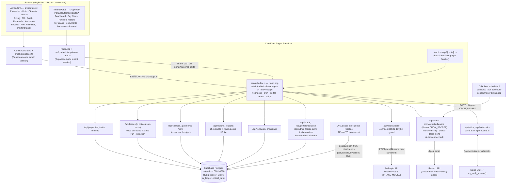

# ORA Property Manager

Internal property-management platform for Oxford Realty Advisors' industrial/flex portfolio. A single Vite/React SPA serves two front ends from one build — an **admin console** (properties, units, tenants, leases, billing, AR, CAM, renewals, insurance, QuickBooks export) gated to `@oxfordra.net` staff, and a **tenant portal** (pay rent, view lease/documents, upload insurance certs) gated by each tenant's own Supabase login. Both talk to one Hono API deployed as Cloudflare Pages Functions, backed by Postgres on Supabase. Monthly rent/CAM billing, ACH autopay via Stripe, critical-date alerting, and delinquency late fees run as HTTP-triggered cron jobs called by the ORA scheduler (Cloudflare Pages has no native cron).

## Architecture



**Reading the diagram:** the admin app and tenant portal are two independent route trees and two independent Supabase sessions sharing one API; every `/api/*` request is admin-JWT-gated except the five explicitly exempted prefixes (webhooks need a raw body for Stripe signature verification, cron uses its own Bearer-secret check, and portal/health/stripe have their own gates). The only outbound third-party calls are Anthropic (lease PDF extraction), Stripe (ACH payments/webhooks), and Resend (alert emails) — all server-side, never from the browser.

## Directory Structure

```
functions/api/[[route]].ts   Cloudflare Pages Functions entrypoint — hands every /api/* request to the Hono app
server/                      API layer (Hono), deployed inside the Functions runtime
  index.ts                     App assembly: middleware order, route mounting, admin-exempt path list
  routes/                      One router per resource (properties, units, tenants, leases, charges, payments,
                                cam, expenses, budgets, renewals, insurance, exports, intake, stripe, webhook,
                                cron, portal, portal-auth, portal-insurance, reports)
  middleware/                  admin-auth (staff JWT + ADMIN_EMAILS allowlist + tenant-exclusion check), tenant-auth (portal JWT),
                                error-handler, and the Bearer-secret cron gate (in auth.ts)
  lib/                          Business logic: billing.ts (monthly charge generation), ar-aging.ts (AR buckets),
                                cam.ts (CAM true-up math), iif-export.ts (QuickBooks IIF file), lease-extract.ts
                                (Anthropic PDF extraction), confidentiality.ts (denylist guard), stripe.ts /
                                stripe-events.ts (Stripe client + webhook handling), schemas.ts (Zod validation),
                                rate-limit.ts
  db/client.ts                  Supabase client factory (service role — used only server-side)
src/                          Admin SPA
  router.tsx                    Route table for the staff console (wrapped in AdminAuthGuard + AppShell)
  App.tsx                       Root: QueryClientProvider (TanStack Query) + RouterProvider
  pages/                        One folder per resource, mirroring server/routes/ (properties, tenants, leases,
                                billing, ar, cam, expenses, budgets, renewals, insurance, critical-dates,
                                exports, reports, units, auth)
  components/                   AppShell, AdminAuthGuard, PageHeader, StatusBadge, form/ and ui/ primitives
  lib/                           supabase.ts (admin auth client), api.ts (fetch wrapper incl. file download),
                                mutations.ts, format.ts
  portal/                       Tenant-facing SPA, mounted at /portal/* inside the same build
    PortalApp.tsx / PortalRouter.tsx   Session bootstrap (incl. AAL2 MFA guard) + nested route table
    pages/                        Dashboard, PayNow, PaymentHistory, MyLease, Documents, Insurance, Account, Login
    components/                   PortalShell, PortalMfaChallenge (AAL2 step-up screen)
    lib/                          supabase-portal.ts (separate anon-key client), portal-api.ts, charges.ts, mfa-guard.ts (pure AAL2 decision fn)
supabase/migrations/           Ordered SQL migrations (0001 core entities -> 0010 ar_ledger fix); source of schema truth
scripts/
  import-from-pipeline.mjs      One-time/rerunnable import from the ORA Lease Intelligence Pipeline's TENANTS.json
  trigger-billing.ps1           Windows Task Scheduler entrypoint that POSTs /api/cron/monthly-billing
tests/                         Vitest suites mirroring server/lib, server/routes, server/middleware, src/components,
                                src/portal — run via `npm test`
docs/superpowers/              Design specs and phase plans (design system, UX overhaul, lease intake, prod hardening)
dist/, .wrangler/              Build output and local Wrangler state — not source
```

## Setup & Run

Scripts are taken verbatim from `package.json`; nothing here is invented.

```bash
npm install
cp .env.example .env        # VITE_SUPABASE_URL/ANON_KEY, SUPABASE_URL/SERVICE_ROLE_KEY, CRON_SECRET,
                             # ANTHROPIC_API_KEY, CONFIDENTIAL_TERMS, INTAKE_MODEL, STRIPE_* keys

npm run dev                 # vite — dev server on :5173
npm run build                # tsc --noEmit && vite build — typecheck, then production build to dist/
npm run preview              # vite preview
npm test                     # vitest run — one-shot Vitest suite
npm run test:watch           # vitest — watch mode
npm run typecheck            # tsc --noEmit
npm run lint                 # tsc --noEmit (lint is currently an alias for typecheck — no separate linter configured)
```

Deployment is Cloudflare Pages, driven by `wrangler.toml` (`name = "ora-pm"`, build output `./dist`):

1. Create a Supabase project; run `supabase db push` to apply `supabase/migrations/`.
2. Connect the GitHub repo to Cloudflare Pages — build command `npm run build`, output directory `dist`.
   Plaintext env vars: `VITE_SUPABASE_URL`, `VITE_SUPABASE_ANON_KEY`. Encrypted secrets (`wrangler pages secret put <NAME>`): `SUPABASE_URL`, `SUPABASE_SERVICE_ROLE_KEY`, `CRON_SECRET`, `STRIPE_SECRET_KEY`, `STRIPE_WEBHOOK_SECRET`, `ANTHROPIC_API_KEY`, `CONFIDENTIAL_TERMS`, `ADMIN_EMAILS`.
3. Configure Cloudflare Access (Zero Trust) on the Pages deployment — allow `ggoldberg@oxfordra.net`, `egoldberg@oxfordra.net`.
4. DNS (`pm.oxfordra.net`, `tenant.oxfordra.net` CNAME to `ora-pm.pages.dev`) — **requires Gabriel's explicit go-ahead before changing.**

**Adding a new admin (OI-036):** admin accounts do not self-provision. In the Supabase dashboard, create the auth user for the new admin's `@oxfordra.net` address (Authentication → Users → Add user; no password needed, they'll sign in via magic link). Then add that exact email to the `ADMIN_EMAILS` secret — a comma-separated exact-match allowlist, case-insensitive — via `wrangler pages secret put ADMIN_EMAILS` (re-enter the full list; this overwrites, it does not append). `adminAuthMiddleware` (`server/middleware/admin-auth.ts`) fails closed with a 503 if `ADMIN_EMAILS` is unset or empty, and separately rejects with 403 any allowlisted email that also resolves to a `tenants` row — an admin cannot also be a tenant contact.

**Tenant MFA lockout recovery (OI-045):** the tenant portal's Account page (`src/portal/pages/PortalAccount.tsx`) lets a tenant enroll a TOTP authenticator; `PortalApp.tsx`'s AAL2 guard (`src/portal/lib/mfa-guard.ts`) then requires a challenge/verify step on every subsequent login once a factor is verified. If a tenant loses their authenticator device (phone lost/reset, app uninstalled) they cannot self-service — there is no backup-code flow. Recovery: in the Supabase dashboard, Authentication → Users → select the tenant → remove their MFA factor(s) (equivalent to calling the admin `mfa.listFactors`/`deleteFactor` API for that user). This drops them back to `aal1`, clearing the guard, and they can log in and re-enroll from the Account page. There is no in-app tenant self-recovery path by design — an admin action is required.

Cron jobs have no native Cloudflare Pages trigger — the ORA fleet scheduler (or, as a fallback, Windows Task Scheduler running `scripts/trigger-billing.ps1` on the 1st of the month) POSTs to `/api/cron/monthly-billing`, `/api/cron/critical-dates-alerts`, and `/api/cron/delinquency-check` with `Authorization: Bearer <CRON_SECRET>`.

## Key Modules & Routes

| Module | Purpose |
|---|---|
| `server/routes/properties.ts`, `units.ts`, `tenants.ts` | CRUD for the core portfolio entities; `tenants.ts` also serves the `/correspondence` sub-route (tenant contact log) |
| `server/routes/leases.ts` | Lease CRUD plus a `/notices` sub-route for lease-related notice tracking |
| `server/routes/charges.ts`, `payments.ts` | Charge ledger and payment recording (manual + Stripe-sourced) |
| `server/routes/cam.ts` | CAM reconciliation endpoints backed by `server/lib/cam.ts`'s pro-rata true-up math |
| `server/routes/expenses.ts`, `budgets.ts` | Operating expense entry and budget tracking |
| `server/routes/renewals.ts` | Renewal pipeline endpoints |
| `server/routes/insurance.ts`, `portal-insurance.ts` | Certificate-of-insurance tracking, staff side and tenant-upload side |
| `server/routes/reports.ts` | Rent roll and other read-model reports |
| `server/routes/exports.ts` | `/api/exports/qb-iif` — generates a QuickBooks Desktop IIF file via `server/lib/iif-export.ts` |
| `server/routes/intake.ts` | `/api/intake/lease` — uploads a lease PDF to Claude (`server/lib/lease-extract.ts`) for field extraction, gated by the `confidentiality.ts` filename denylist (fails closed if unconfigured) |
| `server/routes/cron.ts` | The three scheduled jobs: `monthly-billing` (idempotent charge generation + Stripe ACH autopay), `critical-dates-alerts` (90-day-horizon digest, deduped via `sent_notifications`), `delinquency-check` (30-day-grace late fee posting + digest) |
| `server/routes/stripe.ts`, `webhook.ts` | Stripe PaymentIntent creation and webhook ingestion (mounted before CORS so the raw body survives for signature verification) |
| `server/routes/portal.ts`, `portal-auth.ts` | Tenant-portal data endpoints (`tenantAuthMiddleware`) and admin-only tenant invite/revoke (`/api/admin`, still `adminAuthMiddleware`-gated despite the `/api/portal` prefix nearby) |
| `src/pages/*` | One React page per admin resource, routed in `src/router.tsx`, wrapped in `AdminAuthGuard` + `AppShell` |
| `src/portal/*` | Tenant portal SPA mounted at `/portal/*`, with its own Supabase client (`supabase-portal.ts`) and session-gated route tree (`PortalRouter.tsx`) |
| `scripts/import-from-pipeline.mjs` | Idempotent bulk import of rent-roll data from the ORA Lease Intelligence Pipeline's `TENANTS.json`, using the service-role key to bypass RLS |

## Notes & Gotchas

- **Admin gating is prefix-based, not path-exact.** `/api/admin` (tenant invite/revoke, in `portal-auth.ts`) is *intentionally excluded* from `server/index.ts`'s `ADMIN_EXEMPT` list — a code comment flags this deliberately, since those are privileged actions even though the route lives conceptually next to the exempt `/api/portal` prefix. Read `ADMIN_EXEMPT` in `server/index.ts` before adding a new route under `/api/portal*` or `/api/admin*`.
- **Lease-intake confidentiality guard only scans the filename, not PDF content** (Phase 2a scope — full server-side PDF text extraction is deferred; the Cloudflare Worker runtime has no clean PDF parser). It fails closed if `CONFIDENTIAL_TERMS` is unset, and re-scans extracted field text post-extraction as defense-in-depth. See the in-code comment in `server/routes/intake.ts`.
- **Two separate Supabase Auth contexts by design**: the admin console's client (`src/lib/supabase.ts`) and the tenant portal's client (`src/portal/lib/supabase-portal.ts`) both use the anon key from the browser — the service-role key never leaves `server/db/client.ts`. Admin access additionally requires the authenticated email to be on the `ADMIN_EMAILS` exact-match allowlist and to not resolve to any `tenants` row (`admin-auth.ts`, OI-036) — not merely an `@oxfordra.net` domain suffix, since one Supabase auth project serves both admin and tenant audiences.
- **Webhook route must be mounted before the CORS middleware** — Stripe signature verification needs the untouched raw request body.
