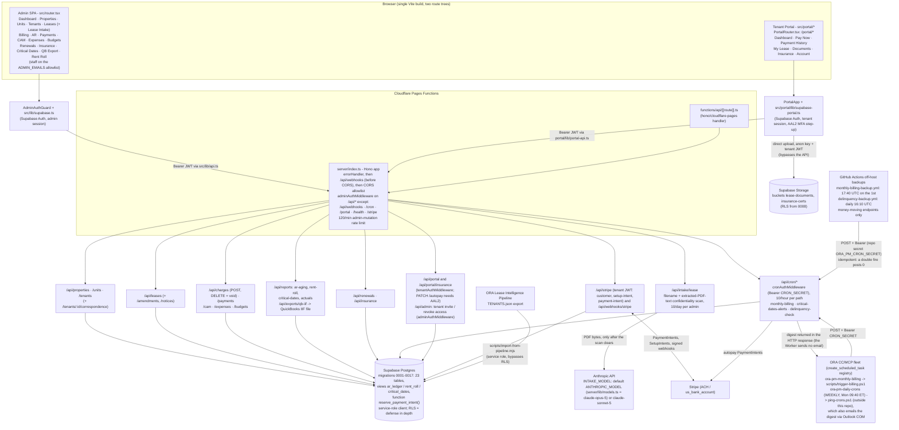
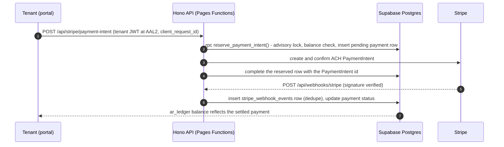
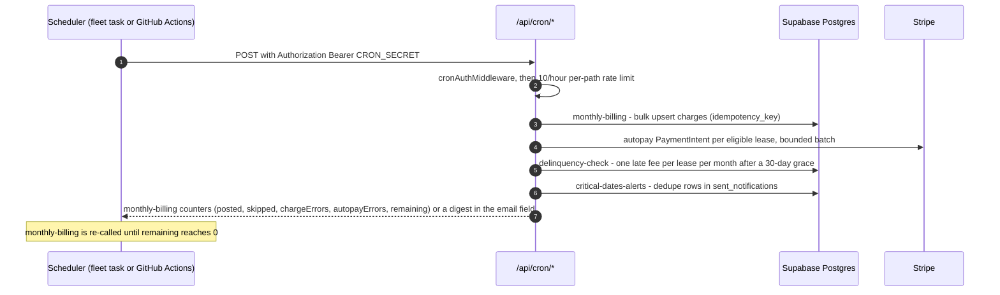

# ORA Property Manager

Internal property-management platform for Oxford Realty Advisors' industrial/flex portfolio. A single Vite/React SPA serves two front ends from one build — an **admin console** (properties, units, tenants, leases, billing, AR, CAM, renewals, insurance, QuickBooks export) gated to `@oxfordra.net` staff, and a **tenant portal** (pay rent, view lease/documents, upload insurance certs) gated by each tenant's own Supabase login. Both talk to one Hono API deployed as Cloudflare Pages Functions, backed by Postgres on Supabase. Monthly rent/CAM billing, ACH autopay via Stripe, critical-date alerting, and delinquency late fees run as HTTP-triggered cron jobs called by the ORA scheduler (Cloudflare Pages has no native cron).

## Architecture

### System architecture


<!-- diagram-verified: 2026-10-28 -->

**Reading the diagram:** the admin app and tenant portal are two independent route trees and two independent Supabase sessions sharing one API. Every `/api/*` request is admin-gated except five exempted prefixes (`ADMIN_EXEMPT` in `server/index.ts`): webhooks need the raw body for Stripe signature verification, cron uses its own Bearer-secret check, and portal, health and stripe have their own gates (`/api/admin` is deliberately not exempt). The only outbound third-party calls are Anthropic (lease PDF extraction) and Stripe (ACH payments, autopay, webhooks), all made server-side. The one browser path that skips the API is the tenant portal's insurance-certificate upload straight to Supabase Storage. The Worker sends no email: `critical-dates-alerts` and `delinquency-check` return the digest in the response (`email` field) and the scheduler task sends it (OI-047).

### Data flows

Tenant ACH payment (Pay Now):



Scheduled cron jobs:



CI/CD and migrations:

```mermaid
flowchart LR
    Dev["PR or push to main"] --> A
    subgraph CI["ci.yml - job ci (ubuntu, Node 22)"]
        direction TB
        A["npm ci, typecheck, lint (ESLint, 0 warnings), npm test"] --> B["check-deploy-env build (strict on push to main, warn-only otherwise)"]
        B --> B2["PR only: check-deploy-env pages --warn-only"] --> C["npm run build"]
        C --> D["PR only: REFUTE gate (npm run check:refute -- --strict)"]
        D --> E["main push only: tip-of-main check"]
        E --> F["supabase link, then check-migrations-applied.mjs (fails closed if a migration is pending)"]
        F --> G["check-deploy-env pages (Cloudflare production env)"]
        G --> H["wrangler pages deploy ./dist --project-name ora-pm --commit-dirty=true"]
    end
    Man["Manual: DB Migrate workflow (dry_run defaults to true, main only)"] -- "supabase db push" --> PG[("Supabase production")]
    H --> Pages["Cloudflare Pages: ora-pm"]
    Cronwf["delinquency-backup.yml (daily)\nmonthly-billing-backup.yml (1st of month)"] -- "POST /api/cron/*" --> Pages
```



## Directory Structure

```
functions/api/[[route]].ts   Cloudflare Pages Functions entrypoint — hands every /api/* request to the Hono app
server/                      API layer (Hono), deployed inside the Functions runtime
  index.ts                     App assembly: middleware order, route mounting, admin-exempt path list
  routes/                      One router per resource (properties, units, tenants, leases, charges, payments,
                                cam, expenses, budgets, renewals, insurance, exports, intake, stripe, webhook,
                                cron, portal, portal-auth, portal-insurance, reports)
  middleware/                  admin-auth (staff JWT + ADMIN_EMAILS allowlist + tenant-exclusion check), tenant-auth (portal JWT),
                                aal-guard (requireAal2: completed MFA challenge required on money-movement routes),
                                error-handler, and the Bearer-secret cron gate (cronAuthMiddleware, in auth.ts)
  lib/                          Business logic: billing.ts (monthly charge generation), ar-aging.ts (AR buckets),
                                cam.ts (CAM true-up math), iif-export.ts (QuickBooks IIF file), lease-extract.ts
                                (Anthropic PDF extraction), pdf-extract.ts (unpdf text extraction for the intake
                                content scan), confidentiality.ts (denylist guard), stripe.ts / stripe-events.ts
                                (Stripe client + webhook event handling), schemas.ts (Zod validation),
                                rate-limit.ts (throttle: per-isolate memory until RATE_LIMIT_KV is provisioned), postgrest-paging.ts (keyset / chunked reads
                                under PostgREST's row cap), api-error.ts (sanitized DB error responses),
                                models.ts (single ANTHROPIC_MODEL constant, OI-256)
  db/client.ts                  Supabase client factory (service role — used only server-side)
src/                          Admin SPA
  router.tsx                    Route table for the staff console (wrapped in AdminAuthGuard + AppShell)
  App.tsx                       Root: QueryClientProvider (TanStack Query) + RouterProvider
  pages/                        Dashboard.tsx, StyleGuide.tsx, plus one folder per resource (properties, tenants,
                                leases incl. LeaseIntake, billing, ar, payments, cam, expenses, budgets, renewals,
                                insurance, critical-dates, exports, reports/RentRoll, units, auth, admin/
                                TenantPortalAdmin - the portal invite/revoke panel on the tenant page)
  components/                   AppShell, AdminAuthGuard, PageHeader, StatusBadge, form/ and ui/ primitives
  lib/                           supabase.ts (admin auth client), api.ts (fetch wrapper incl. file download),
                                api-error.ts, mutations.ts, format.ts, validation.ts
  portal/                       Tenant-facing SPA, mounted at /portal/* inside the same build
    PortalApp.tsx / PortalRouter.tsx   Session bootstrap (incl. AAL2 MFA guard) + nested route table
    pages/                        Dashboard, PayNow, PaymentHistory, MyLease, Documents, Insurance, Account, Login
    components/                   PortalShell, PortalMfaChallenge (AAL2 step-up screen)
    lib/                          supabase-portal.ts (separate anon-key client), portal-api.ts, charges.ts, pay-attempt.ts, mfa-guard.ts (pure AAL2 decision fn)
supabase/migrations/           Ordered SQL migrations 0001-0017 (0001 core entities -> 0017 void of pre-guard late fees);
                                source of schema truth. Read supabase/migrations/README.md first: it explains why the
                                RLS policies do not protect API traffic and how migrations reach production
scripts/
  import-from-pipeline.mjs      One-time/rerunnable import from the ORA Lease Intelligence Pipeline's TENANTS.json
  trigger-billing.ps1           Entrypoint for the ora-pm-monthly-billing fleet task: drains POST /api/cron/monthly-billing
  delinquency-backup.sh         Off-host POST of /api/cron/delinquency-check (used by delinquency-backup.yml);
                                self-test: delinquency-backup.test.sh
  check-deploy-env.mjs          CI gate: required/deferred env vars on the build and on Cloudflare Pages production
  check-migrations-applied.mjs  CI deploy gate: fails closed if a local migration is not applied remotely
  check-refute-required.ts      CI gate (npm run check:refute): financial-decision files need a Refute-Reviewed / Refute-Skip commit trailer
  prepare-migration-for-dashboard.mjs   Wraps a migration + tracking INSERT for the Dashboard-paste fallback
  verify-rls.sql                Manual, read-only check that the claimed RLS policies exist on the live database
evals/lease-intake-model-eval/  Opt-in accuracy eval for INTAKE_MODEL candidates (synthetic fixtures; real API cost) -
                                npm run eval:lease-intake-model; see its README
.github/workflows/              ci.yml, db-migrate.yml, delinquency-backup.yml, monthly-billing-backup.yml
public/_headers                 Cloudflare Pages security headers (CSP currently Report-Only)
tests/                         Vitest suites (npm test): components, config, db (pg-mem migration tests), evals, lib,
                                middleware, portal, routes, scripts, unit; shared helpers in fixtures/ and setup.ts
dist/, .wrangler/              Build output and local Wrangler state — not source
```

## Setup & Run

Scripts are taken verbatim from `package.json`.

```bash
npm install
cp .env.example .env        # VITE_SUPABASE_URL/ANON_KEY, SUPABASE_URL/SERVICE_ROLE_KEY, CRON_SECRET,
                             # ANTHROPIC_API_KEY, CONFIDENTIAL_TERMS, INTAKE_MODEL, STRIPE_SECRET_KEY,
                             # STRIPE_WEBHOOK_SECRET, VITE_STRIPE_PUBLISHABLE_KEY
                             # (ADMIN_EMAILS is read by the API but is not in .env.example - add it for local admin access)

npm run dev                 # vite — dev server on :5173
npm run build                # tsc --noEmit && vite build — typecheck, then production build to dist/
npm run preview              # vite preview
npm test                     # vitest run — one-shot Vitest suite
npm run test:watch           # vitest — watch mode
npm run typecheck            # tsc --noEmit
npm run lint                 # eslint . --max-warnings 0 (flat config: eslint.config.js)
npm run check:refute         # tsx scripts/check-refute-required.ts - REFUTE-trailer gate (CI runs it with --strict on PRs)
npm run eval:lease-intake-model   # tsx evals/lease-intake-model-eval/run-eval.ts - needs a real ANTHROPIC_API_KEY, incurs API cost
```

Deployment is Cloudflare Pages, driven by `wrangler.toml` (`name = "ora-pm"`, build output `./dist`):

1. Create a Supabase project and apply `supabase/migrations/` through the manual **DB Migrate** workflow (`.github/workflows/db-migrate.yml`: `workflow_dispatch` only, `dry_run` defaults to true, runs only off `main`; repo secrets `SUPABASE_ACCESS_TOKEN` and `SUPABASE_DB_PASSWORD`). The Dashboard-paste fallback (`scripts/prepare-migration-for-dashboard.mjs`) and the tracking rules are in `supabase/migrations/README.md`. Apply a migration BEFORE deploying the app code that depends on it.
2. Deploy is `.github/workflows/ci.yml` (Node 22). On every PR and push to `main`: `npm ci` -> typecheck -> lint -> test -> `check-deploy-env.mjs build` -> build. On PRs it also runs the REFUTE gate (`npm run check:refute -- --strict`). On a push to `main`, and only if the commit is still the tip of `main`: link the production Supabase project, `check-migrations-applied.mjs` (fails closed when a local migration is not yet applied remotely), `check-deploy-env.mjs pages` (fails when a required runtime var is missing from Pages production), then `npx wrangler pages deploy ./dist --project-name ora-pm`. Runs are serialized per ref with a `concurrency` group: `main` runs are never cancelled mid-deploy, PR runs are cancelled when superseded. Repo secrets used by CI: `VITE_SUPABASE_URL`, `VITE_SUPABASE_ANON_KEY`, `VITE_STRIPE_PUBLISHABLE_KEY`, `CLOUDFLARE_ACCOUNT_ID`, `CLOUDFLARE_API_TOKEN`, `SUPABASE_ACCESS_TOKEN`, `SUPABASE_DB_PASSWORD`. Whether the Cloudflare Pages Git integration is disconnected (so CI is the sole deploy path) cannot be verified from the repo; check `wrangler pages project list`.
   Build-time vars (GitHub secrets, inlined by Vite): `VITE_SUPABASE_URL`, `VITE_SUPABASE_ANON_KEY` (required) and `VITE_STRIPE_PUBLISHABLE_KEY` (deferred). Runtime secrets on Pages (`wrangler pages secret put <NAME>`), as classified in `scripts/check-deploy-env.mjs`: required - `SUPABASE_URL`, `SUPABASE_SERVICE_ROLE_KEY`, `CRON_SECRET`, `ADMIN_EMAILS`, `CONFIDENTIAL_TERMS`, `ANTHROPIC_API_KEY`; deferred until tenant payments launch - `STRIPE_SECRET_KEY`, `STRIPE_WEBHOOK_SECRET`; optional - `INTAKE_MODEL` (`claude-opus-5` default, `claude-sonnet-5` also allowed; any other value falls back to the default). The optional `RATE_LIMIT_KV` KV binding is not provisioned (the `[[kv_namespaces]]` block in `wrangler.toml` is commented out), so rate limiting is per-isolate memory only until it is.
3. Configure Cloudflare Access (Zero Trust) on the Pages deployment — allow `ggoldberg@oxfordra.net`, `egoldberg@oxfordra.net`.
4. DNS (`pm.oxfordra.net`, `tenant.oxfordra.net` CNAME to `ora-pm.pages.dev`) — **requires Gabriel's explicit go-ahead before changing.**

**Adding a new admin (OI-036):** admin accounts do not self-provision. In the Supabase dashboard, create the auth user for the new admin's `@oxfordra.net` address (Authentication → Users → Add user; no password needed, they'll sign in via magic link). Then add that exact email to the `ADMIN_EMAILS` secret — a comma-separated exact-match allowlist, case-insensitive — via `wrangler pages secret put ADMIN_EMAILS` (re-enter the full list; this overwrites, it does not append). `adminAuthMiddleware` (`server/middleware/admin-auth.ts`) fails closed with a 503 if `ADMIN_EMAILS` is unset or empty, and separately rejects with 403 any allowlisted email that also resolves to a `tenants` row — an admin cannot also be a tenant contact.

**Tenant MFA lockout recovery (OI-045):** the tenant portal's Account page (`src/portal/pages/PortalAccount.tsx`) lets a tenant enroll a TOTP authenticator; `PortalApp.tsx`'s AAL2 guard (`src/portal/lib/mfa-guard.ts`) then requires a challenge/verify step on every subsequent login once a factor is verified. If a tenant loses their authenticator device (phone lost/reset, app uninstalled) they cannot self-service — there is no backup-code flow. Recovery: in the Supabase dashboard, Authentication → Users → select the tenant → remove their MFA factor(s) (equivalent to calling the admin `mfa.listFactors`/`deleteFactor` API for that user). This drops them back to `aal1`, clearing the guard, and they can log in and re-enroll from the Account page. There is no in-app tenant self-recovery path by design — an admin action is required.

Cron jobs have no native Cloudflare Pages trigger — two ORA CC/MCP fleet tasks (`create_scheduled_task` registry, `~/.claude/scheduled-tasks/`) POST to them with `Authorization: Bearer <CRON_SECRET>`, both reading the same `CRON_SECRET` from different local sources. `ora-pm-monthly-billing` (registered 2026-08-21, cron `10 11 1 * *`) runs `scripts/trigger-billing.ps1`, which POSTs to `/api/cron/monthly-billing` on the 1st of the month, authenticated via `$env:ORA_PM_CRON_SECRET`. An off-host backup, `.github/workflows/monthly-billing-backup.yml` (GitHub Actions, `40 17 1 * *` UTC = 90-150 min after the laptop slot and always in a later fixed-hour bucket of the 10/hour cron rate limit, repo secret `ORA_PM_CRON_SECRET`), re-drains the same endpoint so a laptop outage on the 1st (as on 2026-09-01) no longer defers charge posting to the next app open; the upsert is idempotent, so a double fire posts 0. `ora-pm-daily-crons` (registered 2026-08-16, superseding the standalone "ORA PM Crons" Windows Task Scheduler task, since disabled) runs `C:\Users\Owner\ora-pm-cron\ping-crons.ps1`, which POSTs to `/api/cron/critical-dates-alerts` and `/api/cron/delinquency-check` — **weekly since the 2026-09-17 fleet-wide cadence change (live cron `40 9 * * 1`, Mondays 09:40 ET; the task id still says "daily"), not daily** — authenticated via `C:\Users\Owner\ora-pm-cron\cron-secret.txt`, and, since OI-047, also sends the resulting digest via Outlook COM (the Worker no longer emails directly — see the `email` field on each endpoint's response, and `RECIPIENTS` note in `server/routes/cron.ts`). An off-host backup for the money-moving half of that task, `.github/workflows/delinquency-backup.yml` (GitHub Actions, `10 16 * * *` UTC, same repo secret `ORA_PM_CRON_SECRET`, logic in `scripts/delinquency-backup.sh`), re-fires `/api/cron/delinquency-check` only; late fees are one per lease per month, so a double fire posts 0. It deliberately never calls `critical-dates-alerts`, whose dedup rows are written before its digest is returned — only the laptop run can deliver that digest (OI-229). What the weekly cadence costs: late fees are unaffected (the GitHub Actions backup still fires daily), and a critical-date alert fires once per lease/certificate when it first enters the 90-day horizon, so weekly delivery means it arrives at 83–90 days out instead of 90. It also leaves that daily backup as the only daily database traffic, and the Supabase free plan pauses a project after 7 days without activity: while GitHub billing blocked every Actions job (2026-10-06 to 10-31), the project paused on 2026-10-12, and from then on every database-backed route failed, admin console and tenant portal included; the cron routes returned HTTP 500 with Cloudflare `error code: 1016` (origin DNS error, because a paused project's host stops resolving). Restoring the project from the Supabase dashboard is the fix. `scripts/delinquency-backup.sh` now names that cause in its job log, and the billing backup prints the raw body. The live scheduled-task registry is the authority for these crons, not this file; the task names, cadences and the `ping-crons.ps1` / Outlook COM behavior above are recorded from that registry and cannot be verified from this repo. Comment blocks in `wrangler.toml` and `server/routes/cron.ts` still describe an older standalone Windows Task Scheduler setup ("ORA PM Crons", daily cadence) and `wrangler.toml` says `monthly-billing` is not yet wired to a trigger; both are out of date (`scripts/trigger-billing.ps1` and `monthly-billing-backup.yml` exist and call it). The endpoints behave as follows: `monthly-billing` is rate limited to 10 calls/hour per path, processes at most 8 autopay debits per call (`AUTOPAY_BATCH_LIMIT`) and returns `posted`, `skipped`, `chargeErrors`, `autopayErrors` and `remaining`; callers re-invoke it until `remaining` is 0 (`trigger-billing.ps1` caps at 8 invocations).

## Key Modules & Routes

| Module | Purpose |
|---|---|
| `server/routes/properties.ts`, `units.ts`, `tenants.ts` | CRUD for the core portfolio entities; `tenants.ts` also serves the `/correspondence` sub-route (tenant contact log) |
| `server/routes/leases.ts` | Lease list/get/create/update, `POST /:id/amendments`, and `/:id/notices` (GET/POST) for lease-related notice tracking |
| `server/routes/charges.ts`, `payments.ts` | Charge ledger and payment recording (manual + Stripe-sourced). `DELETE /api/charges/:id` voids a charge (sets `voided_at`, migration 0016) rather than deleting the row; an already-voided charge is refused. Balances and listings exclude voided charges |
| `server/routes/cam.ts` | CAM reconciliation: `GET /`, `GET /recoverable-expenses`, `POST /calculate`, `POST /:id/approve`, backed by `server/lib/cam.ts`'s pro-rata true-up math |
| `server/routes/expenses.ts`, `budgets.ts` | Operating expense entry and budget tracking |
| `server/routes/renewals.ts` | Renewal pipeline endpoints |
| `server/routes/insurance.ts`, `portal-insurance.ts` | Certificate-of-insurance tracking, staff side and tenant-upload side |
| `server/routes/reports.ts` | Read-model reports: `/ar-aging`, `/rent-roll`, `/critical-dates`, `/actuals` |
| `server/routes/exports.ts` | `/api/exports/qb-iif` — generates a QuickBooks Desktop IIF file via `server/lib/iif-export.ts` |
| `server/routes/intake.ts` | `POST /api/intake/lease` — uploads a lease PDF (max 10 MB, must be a real PDF) to Claude (`server/lib/lease-extract.ts`) for field extraction. Pre-egress gates: tenant and unit must exist, `CONFIDENTIAL_TERMS` must be configured (503 otherwise), the filename and the extracted PDF text (`pdf-extract.ts`, unpdf) are scanned against the denylist (422 on a hit or when no text layer exists), 10 requests/day per admin. Extracted fields are re-scanned before being returned |
| `server/routes/cron.ts` | The three scheduled jobs: `monthly-billing` (idempotent charge generation + Stripe ACH autopay), `critical-dates-alerts` (90-day-horizon digest, deduped via `sent_notifications`), `delinquency-check` (30-day-grace late fee posting + digest) |
| `server/routes/stripe.ts`, `webhook.ts` | `stripe.ts` (tenant JWT): `POST /customer`, `POST /setup-intent`, `POST /payment-intent` — the last two require AAL2 (`aal-guard.ts`), and payment-intent reserves a pending ledger row via `reserve_payment_intent()` before calling Stripe. `webhook.ts`: `POST /api/webhooks/stripe` (mounted before CORS so the raw body survives signature verification), deduped in `stripe_webhook_events`, events handled in `stripe-events.ts` |
| `server/routes/portal.ts`, `portal-auth.ts` | Tenant-portal data endpoints (`tenantAuthMiddleware`: `/me`, `/charges`, `/payments`, `/lease`, `/documents`, `PATCH /autopay` behind AAL2) and admin-only tenant invite/revoke (`/api/admin/tenants/:id/invite`, `DELETE /api/admin/tenants/:id/revoke-access`; `adminAuthMiddleware`-gated despite the `/api/portal` prefix nearby) |
| `src/pages/*` | React pages for the admin console, routed in `src/router.tsx` and wrapped in `AdminAuthGuard` + `AppShell` (also `/styleguide`, `/rent-roll`, `/units`, `/leases/intake`) |
| `src/portal/*` | Tenant portal SPA mounted at `/portal/*`, with its own Supabase client (`supabase-portal.ts`) and session-gated route tree (`PortalRouter.tsx`) |
| `.github/workflows/*`, `scripts/check-*.{mjs,ts}` | CI deploy pipeline, manual DB Migrate, and the off-host cron backups (see Architecture diagrams); the env, migration-applied and REFUTE gates |
| `scripts/import-from-pipeline.mjs` | Idempotent bulk import of rent-roll data from the ORA Lease Intelligence Pipeline's `TENANTS.json`, using the service-role key to bypass RLS |

## Notes & Gotchas

- **Admin gating is prefix-based, not path-exact.** `/api/admin` (tenant invite/revoke, in `portal-auth.ts`) is *intentionally excluded* from `server/index.ts`'s `ADMIN_EXEMPT` list — a code comment flags this deliberately, since those are privileged actions even though the route lives conceptually next to the exempt `/api/portal` prefix. Read `ADMIN_EXEMPT` in `server/index.ts` before adding a new route under `/api/portal*` or `/api/admin*`.
- **Lease-intake confidentiality guard scans both the filename and the extracted PDF text**, server-side, before anything is sent to Anthropic (`unpdf` in `server/lib/pdf-extract.ts`). It fails closed: no `CONFIDENTIAL_TERMS` configured returns 503, and an image-only/scanned PDF with no text layer returns 422 because the content scan cannot run. Extracted field text is re-scanned after extraction as defense in depth. See `server/routes/intake.ts`.
- **Two separate Supabase Auth contexts by design**: the admin console's client (`src/lib/supabase.ts`) and the tenant portal's client (`src/portal/lib/supabase-portal.ts`) both use the anon key from the browser — the service-role key never leaves `server/db/client.ts`. Admin access additionally requires the authenticated email to be on the `ADMIN_EMAILS` exact-match allowlist and to not resolve to any `tenants` row (`admin-auth.ts`, OI-036) — not merely an `@oxfordra.net` domain suffix, since one Supabase auth project serves both admin and tenant audiences.
- **RLS does not protect API traffic.** `server/db/client.ts` uses the service-role key, which bypasses RLS; tenant isolation on the API is the per-route pattern of resolving the caller's tenant by `auth_user_id` first (pinned by `tests/routes/portal-scoping.test.ts`). The RLS policies are defense in depth for direct client access, and the `insurance-certs` storage upload is the one live direct-client path. Read `supabase/migrations/README.md` before relying on or changing any policy.
- **Financial-decision files need a REFUTE trailer.** A PR touching the money-moving paths enumerated in `scripts/check-refute-required.ts` must carry a `Refute-Reviewed:` or `Refute-Skip:` commit trailer or CI fails.
- **CSP is Report-Only.** `public/_headers` ships `Content-Security-Policy-Report-Only`; it is not yet enforcing.
- **Webhook route must be mounted before the CORS middleware** — Stripe signature verification needs the untouched raw request body.
